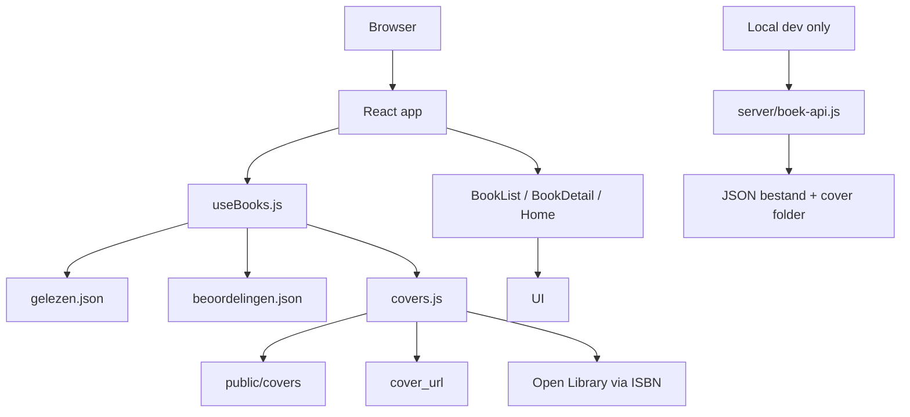

# Technische documentatie - boekenwebsite

## Inhoudsopgave

- [1. Projectoverzicht](#1-projectoverzicht)
- [2. Projectstructuur](#2-projectstructuur)
- [3. Node.js en de gebruikte technologie](#3-nodejs-en-de-gebruikte-technologie)
- [4. Hoe werkt de website?](#4-hoe-werkt-de-website)
- [5. Frontend](#5-frontend)
- [6. Backend en API](#6-backend-en-api)
- [7. Gegevensopslag](#7-gegevensopslag)
- [8. Testen en kwaliteit](#8-testen-en-kwaliteit)
- [9. Opstarten en onderhouden](#9-opstarten-en-onderhouden)
- [10. Technische aandachtspunten](#10-technische-aandachtspunten)
- [11. Samenvatting voor Obsidian](#11-samenvatting-voor-obsidian)

## 1. Projectoverzicht

Dit project is een persoonlijke boekenwebsite / digitale boekenbibliotheek. De code toont een React-applicatie die een overzicht van gelezen boeken, beoordelingen, filters, detailpagina's en een lokaal alternatief voor het toevoegen van boeken ondersteunt.

De belangrijkste functionele onderdelen die in de code zichtbaar zijn:

- lijst van boeken met zoek- en filtermogelijkheden
- detailpagina per boek
- homepage met recent gelezen boeken en favorieten
- optionele lokale API voor het toevoegen en bewerken van boeken tijdens ontwikkeling
- coverafbeeldingen met fallback-logica
- scores/favorieten in aparte JSON-bestanden

Uit de code blijkt dat het project geen volledige productiebestendige backend heeft. De site is in de huidige vorm vooral een statische frontend die data leest uit JSON-bestanden. Er is wel een lokale ontwikkel-API aanwezig, maar die is niet hetzelfde als een permanente productieserver.

Bevestigde technologieën:

- JavaScript / JSX voor de frontend
- CSS via Tailwind
- JSON als bron voor data
- Node.js als runtime voor scripts, build en lokale API tijdens `npm run dev`
- Vite als bundeltool
- React Router voor routing
- GitHub Actions voor deployment naar GitHub Pages

Bewijsmateriaal:

- `package.json`
- `vite.config.js`
- `src/App.jsx`
- `src/hooks/useBooks.js`
- `README.md`
- `server/vite-plugin.js`
- `server/boek-api.js`

### Conclusie

- De website is een frontend-applicatie voor een persoonlijke bibliotheek.
- De broncode toont geen relationele database of backend-database in productie.
- De gegevens worden voornamelijk opgeslagen in JSON-bestanden en lokale coverbestanden.
- Er is een lokale API beschikbaar in de ontwikkelomgeving, maar de productiewversie is statisch.

## 2. Projectstructuur

De projectstructuur is als volgt (relevant subset):

```text
.
├── .github/
│   └── workflows/
│       └── deploy.yml
├── public/
│   └── covers/
│       ├── .gitkeep
│       ├── 9789000372935-voor.jpg
│       ├── 9789002147012-voor.jpg
│       ├── 9789022592687-voor.jpg
│       ├── 9789401413510-voor.jpg
│       └── 9789463823975-voor.jpg
├── scripts/
│   ├── cover-agent.js
│   ├── cover-search-agent.js
│   ├── import-goodreads.js
│   ├── resize-covers.js
│   ├── scan-covers.js
│   ├── validate-data.js
│   ├── zoek-id.js
│   └── lib/
│       └── common.js
├── server/
│   ├── boek-api.js
│   ├── boek-api.test.js
│   └── vite-plugin.js
├── src/
│   ├── api/
│   │   └── boekenApi.js
│   ├── components/
│   │   ├── BookCard.jsx
│   │   ├── CoverImage.jsx
│   │   ├── FilterBar.jsx
│   │   ├── Pagination.jsx
│   │   ├── SearchBar.jsx
│   │   ├── StarPicker.jsx
│   │   ├── Stars.jsx
│   │   └── TerugNaarLijst.jsx
│   ├── data/
│   │   ├── beoordelingen.json
│   │   ├── gelezen.json
│   ├── hooks/
│   │   ├── useBoekenApi.js
│   │   └── useBooks.js
│   ├── pages/
│   │   ├── BoekBewerken.jsx
│   │   ├── BookDetail.jsx
│   │   ├── BookList.jsx
│   │   ├── Home.jsx
│   │   └── NieuwBoek.jsx
│   ├── utils/
│   │   ├── bewerktVelden.js
│   │   ├── covers.js
│   │   ├── filtering.js
│   │   ├── lijstParams.js
│   ├── App.jsx
│   ├── index.css
│   ├── main.jsx
├── .gitignore
├── BEHEER.md
├── README.md
├── index.html
├── package-lock.json
├── package.json
├── postcss.config.js
├── tailwind.config.js
├── vite.config.js
```

### Belangrijkste delen

- `src/pages/`
  - bevat pagina's zoals `Home`, `BookList`, `BookDetail`, `NieuwBoek` en `BoekBewerken`
- `src/components/`
  - herbruikbare UI-componenten zoals kaarten, sterren, filterbalk en coverweergave
- `src/hooks/`
  - bevat `useBooks.js` voor het laden van data en `useBoekenApi.js` voor de lokale API-status
- `src/data/`
  - bevat de opslagbestanden voor de boekgegevens:
    - `gelezen.json`
    - `beoordelingen.json`
- `server/`
  - bevat de lokale API en testbestanden
- `scripts/`
  - bevat Node-scripts voor validation, covers, import en datacontrole
- `public/covers/`
  - bevat lokale boekcovers
- `vite.config.js`
  - bepaalt de Vite-configuratie en de GitHub Pages `base`
- `package.json`
  - scripts, dependencies en test-opdrachten
- `.github/workflows/deploy.yml`
  - deploys de app naar GitHub Pages bij push naar `main`

### Belangrijkste nuance

De projectdocumentatie in `README.md` verwijst naar `src/data/books.json`, maar in de werkelijke repo-structuur zijn de data-bestanden `src/data/gelezen.json` en `src/data/beoordelingen.json`. Dat is een expliciete mismatch tussen documentatie en code. De code is daarmee de sterkste bron voor feiten.

## 3. Node.js en de gebruikte technologie

### 1. Gebruikt het project Node.js?

Ja, dat is duidelijk te zien in de code.

Bewijs:

- `package.json` gebruikt scripts zoals:
  - `node scripts/scan-covers.js`
  - `node scripts/validate-data.js`
  - `node --test server/boek-api.test.js`
- `vite.config.js` importeert Vite en een lokale API-plugin
- `server/vite-plugin.js` gebruikt Node-syntax en wordt gekoppeld aan de Vite dev-server
- `deploy.yml` installeert Node 20 voor deployment

### 2. Waaruit blijkt dat?

Uit de volgende bestanden:

- `package.json`
- `scripts/validate-data.js`
- `server/vite-plugin.js`
- `.github/workflows/deploy.yml`

### 3. Wordt Node.js gebruikt voor de backend, de ontwikkeling, het uitvoeren van scripts of meerdere doeleinden?

Meerdere doeleinden:

- ontwikkeling: `npm run dev` gebruikt Vite
- build: `npm run build`
- validatie: `node scripts/validate-data.js`
- coverbeheer: `node scripts/scan-covers.js`, `node scripts/resize-covers.js`
- tests: `node --test server/boek-api.test.js`
- lokale API: `server/boek-api.js` in de dev-omgeving

Het is niet bewijs dat de productieserver een Node-backend runtime heeft. De productie is statisch en wordt gedeployed naar GitHub Pages.

### 4. Welke package manager wordt gebruikt?

Uit de aanwezigheid van `package-lock.json` en de `npm run` scripts blijkt dat het project `npm` gebruikt.

Er is geen bewijs van `pnpm` of `yarn` in de repo.

### 5. Welke versie van Node.js wordt voorgeschreven of gebruikt?

Er is geen expliciet `engines`-veld in `package.json`.

Wel is in de deploy workflow te zien dat GitHub Actions Node 20 gebruikt:

```yaml
- uses: actions/setup-node@v4
  with:
    node-version: 20
```

Dat betekent:

- De CI/deploymentomgeving gebruikt Node 20.
- De lokale ontwikkelomgeving wordt niet expliciet hardcoded in `package.json`, maar de projectopzet is gebouwd voor een moderne Node-omgeving en Vite 5.

### 6. Welke frameworks worden gebruikt?

- React 18
- React Router DOM
- Vite 5
- Tailwind CSS
- Node.js runtime scripts
- Playwright als dependency
- Sharp voor coververwerking

Bewijs:

- `package.json`
- `vite.config.js`
- `src/main.jsx`
- `src/App.jsx`
- `tailwind.config.js`

### 7. Welke rol heeft iedere technologie?

| Technologie | Rol in het project | Bewijs |
|---|---|---|
| React | Frontend UI-framework | `package.json`, `src/App.jsx`, `src/pages/*.jsx` |
| Vite | Dev-server, bundler en build-tool | `package.json`, `vite.config.js` |
| React Router | Routing voor homepage, boekenlijst, detailpagina's | `src/App.jsx`, `src/main.jsx` |
| Tailwind CSS | Styling van de UI | `tailwind.config.js`, `src/index.css` |
| Node.js | Scripts, build, data-validatie, lokale API, testomgeving | `package.json`, `scripts/*.js`, `server/*.js` |
| JSON | Data-opslag voor boeken en beoordelingen | `src/data/gelezen.json`, `src/data/beoordelingen.json` |
| GitHub Actions | Build + deploy naar GitHub Pages | `.github/workflows/deploy.yml` |
| Sharp | Afbeeldingsverwerking van covers | `package.json`, `scripts/resize-covers.js` |

### 8. Welke opdrachten kan ik uitvoeren om de website te starten, te testen en te bouwen?

Uit `package.json`:

```bash
npm install
npm run dev
npm run build
npm run preview
npm run check
npm run covers
npm run covers:verkleinen
npm test
```

Belangrijk:

- `npm run dev` is de lokale ontwikkelmodus
- `npm run build` is de productiebuild
- `npm run preview` toont de vooraf gebouwde app
- `npm run check` voert de datavalidatie uit
- `npm test` voert de Node-test uit

### 9. Is er een onderscheid tussen de ontwikkelomgeving en de productieomgeving?

Ja, dat verschil is in de code te zien.

- Ontwikkelomgeving:
  - `npm run dev`
  - Vite dev server starts
  - `server/vite-plugin.js` attaches the local API to Vite
  - local API routes are available and used for adding/editing books

- Productieomgeving:
  - `npm run build`
  - output is a static `dist/` build
  - GitHub Actions deploys that static output to GitHub Pages
  - no local Node API is active there

Bewijs:

- `server/vite-plugin.js` stelt expliciet dat deze API alleen in `serve` modus actief is
- `vite.config.js` gebruikt `base: '/boekenwebsite/'` voor GitHub Pages
- `.github/workflows/deploy.yml` deploys build artifacts to Pages

### 10. Welke onderdelen zouden niet functioneren als Node.js niet beschikbaar was?

Zonder Node.js zouden in ieder geval niet werken:

- `npm install`
- `npm run dev`
- `npm run build`
- `npm test`
- `npm run check`
- toegang tot de lokale API in de dev-omgeving
- data-validatie via `scripts/validate-data.js`
- cover-processing scripts
- Vite dev-server en hot reload
- deployment via GitHub Actions

## 4. Hoe werkt de website?

### Stapsgewijze werking

1. De app laadt in de browser.
2. `src/main.jsx` rendert de app in een `BrowserRouter` met `basename="/boekenwebsite"`.
3. `src/App.jsx` definieert de routes:
   - `/`
   - `/boeken`
   - `/boeken/:id`
   - `/boeken/:id/bewerken`
   - `/toevoegen`
4. `useBooks.js` laadt de boeken uit de gegevensbestanden:
   - `src/data/gelezen.json`
   - `src/data/beoordelingen.json`
5. Boekobjecten worden gecombineerd in één model:
   - boekdata
   - score/favoriet/notitie
   - coverkandidaten
6. De UI toont de gegevens via componenten zoals `BookCard`, `BookList`, `Home` en `BookDetail`.
7. Filters en zoektrefwoorden worden in de URL opgeslagen via `useSearchParams`.
8. Coverafbeeldingen worden niet meteen aan één bron gekoppeld; de code zoekt in volgorde:
   - lokale cover in `public/covers`
   - `cover_url` uit het boekrecord
   - Open Library via ISBN
   - fallback `no-cover.jpg`

### Dataflow



### API en toevoegen van boeken

Tijdens ontwikkeling wordt in `vite.config.js` een plugin toegevoegd:

```js
import boekenApi from './server/vite-plugin.js'
plugins: [react(), boekenApi()]
```

Die plugin hangt een API aan de Vite dev-server:

- `server/vite-plugin.js`
- `server/boek-api.js`

In `src/api/boekenApi.js` zijn de calls te zien:

- `GET` aan `/api/status`
- `POST` aan `/api/boeken`
- `PATCH` aan `/api/boeken/:id`

`NieuwBoek.jsx` gebruikt deze API om een nieuw boek op te slaan. De code:

- leest een cover als `data:`-URL
- valideert titel, ISBN, reus etc.
- roept `slaBoekOp(...)` aan
- appends the new book to the in-memory UI via `voegBoekToe(...)`

Belangrijk: deze API is alleen actief in de lokale dev-omgeving via Vite. In de gepubliceerde GitHub Pages-build zit deze backend niet.

### Formulieren en interactie

- `NieuwBoek.jsx` verwerkt een formulier
- `StarPicker.jsx` verwerkt beoordelingen in sterren
- `BookDetail.jsx` laat samenvatting, score, favoriet, notitie en links zien
- `BookList.jsx` gebruikt URL-parameters voor zoekfiltering en paginering

## 5. Frontend

### Framework

Het frontend is gebouwd met React en Vite. De routing gebeurt via `react-router-dom`.

Bevestigd in:

- `src/main.jsx`
- `src/App.jsx`
- `package.json`

### Belangrijkste pagina's

- `src/pages/Home.jsx`
  - recent gelezen en favorieten
  - statistieken per jaar
- `src/pages/BookList.jsx`
  - lijst van alle boeken
  - zoekbalk
  - filters
  - paginering
- `src/pages/BookDetail.jsx`
  - detailweergave van één boek
  - score, notities, samenvatting, cover
- `src/pages/NieuwBoek.jsx`
  - formulier om een boek toe te voegen
  - cover upload
  - validatie
- `src/pages/BoekBewerken.jsx`
  - bewerken van bestaand boek

### Routering en navigatie

`src/App.jsx` definieert alle routes:

```jsx
<Routes>
  <Route path="/" element={<Home />} />
  <Route path="/boeken" element={<BookList />} />
  <Route path="/boeken/:id" element={<BookDetail />} />
  <Route path="/boeken/:id/bewerken" element={<BoekBewerken />} />
  <Route path="/toevoegen" element={<NieuwBoek />} />
</Routes>
```

Er is ook een navigatiebalk met links naar:

- Home
- Alle boeken
- + Boek toevoegen (alleen wanneer de lokale API actief is)

### Gegevensbeheer

De state komt uit `src/hooks/useBooks.js`:

- `useBooks()`
- `useBook(id)`
- `voegBoekToe(...)`
- `werkBoekBij(...)`

Deze hook gebruikt `useSyncExternalStore` om een externe state bij te houden; dat is een opvallende keuze voor een static dataset.

### Hooks

- `useBooks.js`
  - leest `gelezen.json`, `beoordelingen.json` en coverinformatie
  - maakt combinaties van data
  - exposeert collectie en individuele boekgegevens
- `useBoekenApi.js`
  - controleert of de lokale API beschikbaar is

### Communicatie met API's

`src/api/boekenApi.js` bevat fetch-wrappers:

- `haalApiStatus()`
- `slaBoekOp(invoer)`
- `wijzigBoek(id, wijzigingen, origineel, cover)`

Deze functies gebruiken de lokale API als de site via `npm run dev` draait.

### Foutmeldingen en laadstatussen

In de UI worden fouten en statusinformatie expliciet afgehandeld:

- `NieuwBoek.jsx` toont `Even controleren of opslaan mogelijk is…`
- wanneer de API niet beschikbaar is, toont `api === false` een melding
- form validation errors appear as field-specific messages
- failed API writes are surfaced via `fout` objects

## 6. Backend en API

### Is er een backend aanwezig?

Ja, maar alleen in de lokale ontwikkelomgeving.

De repository bevat geen Express-server of echte productie-API. In plaats daarvan gebruikt het project een Vite plugin dat een lokale API middleware toevoegt:

- `server/vite-plugin.js` attaches `maakBoekApi` to the dev server
- `server/boek-api.js` implements the actual logic

### Technologie

De backend is Node.js-based en draait in de Vite dev-server, niet als een apart Express-project.

Geen expliciete `express` dependency is aanwezig in `package.json`. Dat betekent dat het geen standaard Express-app is. De code is een custom API middleware voor de lokale ontwikkelomgeving.

### Startpunt van de server

Het startpunt is:

- `vite.config.js`
- `server/vite-plugin.js`

Daarin staat:

```js
plugins: [react(), boekenApi()]
```

en de plugin gebruikt:

```js
server.middlewares.use(maakBoekApi({ root: server.config.root, basis: server.config.base }))
```

### Beschikbare API routes

Op basis van de frontend-calls zijn de routes:

- `GET /api/status`
- `POST /api/boeken`
- `PATCH /api/boeken/:id`

Deze routes zijn zichtbaar in:

- `src/api/boekenApi.js`

### Verwerking van verzoeken

`server/boek-api.js` verwerkt:

- boekvalidatie
- het lezen en schrijven van JSON
- cover-uploads
- duplicate detection
- storing and updating of book entries

De code toont dat er validatie is op:

- unieke ID
- ISBN
- titel
- auteur
- score
- datum
- covers

### Validatie van gegevens

Er is een expliciet script voor data-validatie:

- `scripts/validate-data.js`

Het controleert:

- `src/data/gelezen.json`
- `src/data/beoordelingen.json`
- `public/covers/`

Het script gaat onder meer na:

- of IDs uniek zijn
- of `datum_gelezen` correct is
- of ISBN geldig is
- of JSON-structuren logisch zijn
- of covernamen correct zijn

### Opslag en ophalen

De code laat zien dat de brondata wordt bewaard in:

- `src/data/gelezen.json`
- `src/data/beoordelingen.json`
- `public/covers/`

Het is niet bewezen dat er een database aanwezig is.

### Foutafhandeling

De API retourneert in de frontend al een gestandaardiseerd foutformaat:

```js
return { ok: false, fout: data?.fout ? data : { fout: ... } }
```

De UI toont die fouten in `NieuwBoek.jsx` en de bewerkingspagina.

### Beveiligingsmaatregelen

In de onderzochte code is geen duidelijke beveiliging aanwezig:

- geen login
- geen sessies
- geen auth middleware
- geen database-auth

Er is dus geen expliciete beveiligingslaag in deze repo gevonden. De site lijkt primair als persoonlijke, lokale / GitHub Pages-gebaseerde bibliotheek te werken.

## 7. Gegevensopslag

### Gedeeltelijk bewijs voor opslagmethodes

De code toont geen relationele database of documentdatabase. Wat er wel in beeld is:

- `src/data/gelezen.json` — voor boekrecords
- `src/data/beoordelingen.json` — voor score/favoriet/notitie
- `public/covers/` — lokale coverafbeeldingen
- `cover_url` in boekobjecten — externe URL's
- `goodreads_id` en hyperlinks — externe referenties

### Conclusie over opslag

| Opslagvorm | Gebruikt? | Bewijs |
|---|---|---|
| JSON-bestanden | Ja | `src/data/*.json` |
| Relationele database | Nee, niet bewezen | Geen DB-configuratie gevonden |
| Documentdatabase | Nee, niet bewezen | Geen DB-configuratie gevonden |
| Browser localStorage | Niet in de code gevonden | Geen gebruik in de geinspecteerde bestanden |
| Externe API | Ja, deels | Open Library cover URL logic in `src/utils/covers.js` |
| Bestandsopslag in `public/` | Ja | `public/covers/` |

### Lees- en schrijfproces

- `useBooks.js` leest de JSON-bestanden in bij module-load
- `BookList`, `Home`, `BookDetail` gebruiken die data
- `NieuwBoek.jsx` uploadt een cover en stuurt de boekinfo naar de lokale API
- de API schrijft lokaal aan de JSON-data en covermap

### Tijdsafhankelijkheid

- tijdelijke UI-state: "preview" van cover in `NieuwBoek.jsx` via `URL.createObjectURL`
- permanente gegevens: JSON + lokale coverbestanden

### Belangrijk

Er is geen code gevonden die een permanente online database gebruikt. De repository is consistent met een static-site model, waarbij de data als lokaal JSON bestand aanwezig is.

## 8. Testen en kwaliteit

### Testframeworks

Er is in `package.json` een test-script:

```json
"test": "node --test server/boek-api.test.js"
```

Dat betekent dat een Node native test-runner wordt gebruikt. Er is dus een testbestand aanwezig:

- `server/boek-api.test.js`

### Waar staan de tests?

- `server/boek-api.test.js`
- `src/utils/bewerkVelden.test.js`
- `src/utils/lijstParams.test.js`

Deze bestanden zijn zichtbaar in de projectstructuur.

### Wat wordt getest?

De code toont dat er tests zijn voor:

- API-functionality
- data-validatie-logica
- helper-functies voor het bewerken van velden
- lijstparameter-logica

### Linting / formatting

Er is geen expliciete lint- of formatterconfiguratie gevonden in de hoofdstructuur van dit project, zoals:

- `.eslintrc`
- `.prettierrc`
- `eslint.config.*`

Dat betekent niet dat er geen tooling zou kunnen bestaan, maar uit de geinspecteerde repo-structuur is dat niet bevestigd.

### Kwaliteitscontroles

De project scripts bieden een aantal checks:

```bash
npm run check
npm run covers
npm run build
npm test
```

De validatie van data is expliciet gebouwd in:

- `scripts/validate-data.js`

Deze script wordt automatisch gestart vóór build en dev.

### Belangrijk

De site bevat duidelijke data-validatie, maar er is geen uitgebreide testcoverage voor alle UI-flows zichtbaar in het project.

## 9. Opstarten en onderhouden

### Vereiste software

Voor ontwikkeling is in de code een moderne Node-omgeving nodig, inclusief:

- Node.js
- npm

Volgens de CI-config is Node 20 de verwachte versie in deployment.

### Controleer of Node en npm aanwezig zijn

```bash
node -v
npm -v
```

### Dependencies installeren

Vanuit de projectroot:

```bash
npm install
```

### Lokale website starten

```bash
npm run dev
```

De lokale app draait normaal gesproken op:

```text
http://localhost:5173/boekenwebsite/
```

### Productiebouw

```bash
npm run build
```

### Preview van de build

```bash
npm run preview
```

### Data-validatie handmatig

```bash
npm run check
```

### Covers scannen

```bash
npm run covers
```

### Covers verkleinen

```bash
npm run covers:verkleinen
```

### Tests uitvoeren

```bash
npm test
```

### Als de website niet start

De code geeft een aantal aanwijzingen:

- controleer `vite.config.js` op `base`
- controleer `src/main.jsx` op `basename`
- run `npm install`
- run `npm run check`
- check of de JSON-data correct is
- check of `server/boek-api.js` actief is in dev mode

### Opmerking over de projectroot

Alle commando's hierboven worden uitgevoerd vanuit de projectroot, tenzij expliciet anders vermeld.

## 10. Technische aandachtspunten

Deze punten zijn gebaseerd op wat in de code zichtbaar is; ze zijn niet zonder meer een bug, maar wel aandachtspunten.

### 1. Documentatie en daadwerkelijke code zijn niet altijd identiek

`README.md` verwijst naar `src/data/books.json`, maar in de repo zijn de werkelijke datafiles:

- `src/data/gelezen.json`
- `src/data/beoordelingen.json`

Dat kan verwarrend zijn voor onderhouders.

### 2. Mogelijke ontbrekende of verouderde import

`src/hooks/useBooks.js` importeert:

```js
import coversData from '../data/covers.json'
```

maar in de geinspecteerde file tree ontbreekt `src/data/covers.json`. Dat is een duidelijke mismatch tussen import en bestandstructuur. Geen duidelijke bewijs dat de app niet werkt, maar wel een technisch aandachtspunt.

### 3. Productie is statisch; mutation is alleen lokaal

Het project is zeer geschikt voor GitHub Pages, maar het staat niet op een echte productiebestendige backend. Opslaan en bewerken van boeken is in de huidige code gekoppeld aan de lokale dev-omgeving.

### 4. Geen expliciete beveiliging of authenticatie

Er is geen login, geen auth, geen serverauth, geen user management gevonden.

### 5. Geen duidelijke database in productie

De code toont JSON-opslag, niet een relatie- of documentdatabase.

### 6. Deployment is gekoppeld aan repo-name

`vite.config.js` bevat een `base`-waarde:

```js
base: '/boekenwebsite/'
```

en `src/main.jsx` bevat een bijpassende `basename`. Dat is essentieel voor correcte GitHub Pages-routing.

### 7. Verificatie en scripts zijn aanwezig

Er is goede data-validatie, maar het is nog geen uitgebreide CI-architectuur. De projectstructuur toont validatie, tests en deployment, maar niet per se een brede lint- of typecheck-pijplijn.

## 11. Samenvatting voor Obsidian

### Korte samenvatting

Dit is een persoonlijke boekenwebsite: een statische React-app voor het tonen van een bibliotheek, recent gelezen boeken, scores, detailpagina's en filters.

De basis bestaat uit:

- React
- Vite
- React Router
- Tailwind
- JavaScript / JSX
- JSON-bestanden als data-bron
- Node.js voor scripts en lokale dev API

### Gebruikt de website Node.js?

Ja, maar met een verschil tussen ontwikkeling en productie:

- Node.js wordt gebruikt voor build, scripts, validatie en de lokale API in `npm run dev`
- de productiewversie is statisch en wordt via GitHub Pages gehost
- er is geen bewijs van een echte productiedatabase of Apollo/Express-variant

### Rol van Node.js

Node.js is niet het hoofdproductiesysteem; hier is de rol:

- dev server
- build tooling
- validation scripts
- local API during development
- cover processing
- tests

### Belangrijkste bestanden

- `src/App.jsx` — routing
- `src/pages/` — pagina's
- `src/hooks/useBooks.js` — data access
- `src/data/gelezen.json` — boekgegevens
- `src/data/beoordelingen.json` — scores/favoriet
- `server/boek-api.js` — lokale API
- `scripts/validate-data.js` — data checks
- `vite.config.js` — build and base config
- `.github/workflows/deploy.yml` — deployment

### Hoe start ik de website?

```bash
npm install
npm run dev
```

### Hoe test ik de website?

```bash
npm test
npm run check
```

### Waar worden boekgegevens bewaard?

In JSON-bestanden:

- `src/data/gelezen.json`
- `src/data/beoordelingen.json`

En coverafbeeldingen in:

- `public/covers/`

### Welke onderdelen moet ik begrijpen als ik de website wil uitbreiden?

- `src/hooks/useBooks.js`
- `src/utils/covers.js`
- `src/pages/BookList.jsx`
- `src/pages/BookDetail.jsx`
- `server/boek-api.js`
- `scripts/validate-data.js`

### Belangrijkste openstaande technische vragen

- Is `src/data/covers.json` bedoeld, of is de import een verouderde referentie?
- Waarom verwijst de README naar `src/data/books.json` terwijl de werkelijke data in `gelezen.json` staat?
- Is de lokale API alleen voor ontwikkeling of is er een toekomstig backend-plan?
- Hoe wordt de data in de toekomst geversioneerd of onderhouden?
- Is de site bedoeld om te blijven op GitHub Pages of later naar een andere hostingomgeving te migreren?

### Tabel met technologieën en functie

| Technologie | Functie |
|---|---|
| React | UI-framework voor de website |
| Vite | Dev-server en build-tool |
| React Router | Navigatie tussen pagina's |
| Tailwind CSS | Styling en layout |
| Node.js | Scripts, validation, dev API, build process |
| JSON | Databron voor boeken en beoordelingen |
| GitHub Actions | Deploy naar GitHub Pages |
| Sharp | Verkleinen van coverafbeeldingen |
| Playwright | Dependency aanwezig, maar geen directe UI-suite is in de repo als duidelijke kern gevonden |

## Slotopmerking

De code ondersteunt het beeld van een persoonlijke, statische React-boekenwebsite met een local-only API voor ontwikkeling, waarbij de daadwerkelijke data in JSON-bestanden wordt opgeslagen. Node.js is zeker gebruikt, maar vooral voor development, scripts en lokale API-functionaliteit, niet als een volledige production backend. De repo bevat voldoende kwaliteitscontroles om de data en build te bewaken, maar er blijven enkele documentatie- en import-ongelijkheden die bij onderhoud aandacht verdienen.
